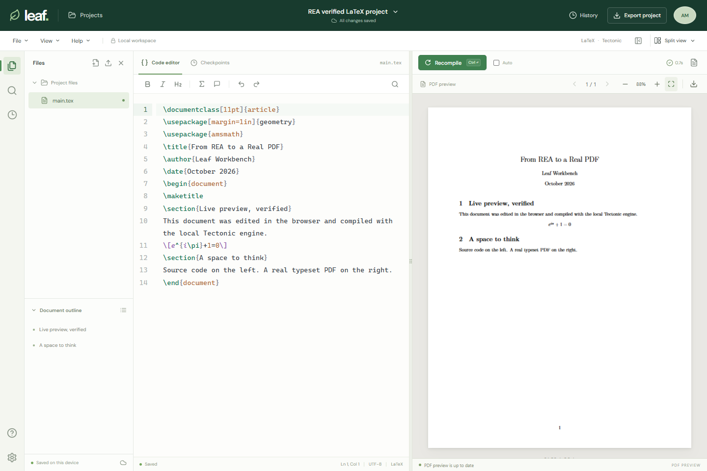
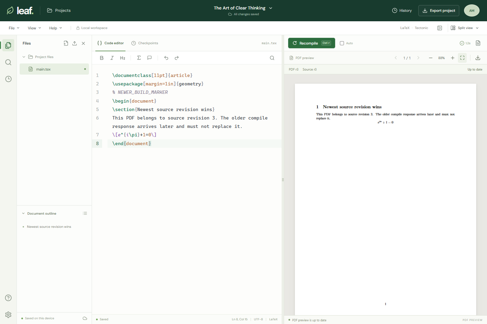

# Leaf Workbench

### A local LaTeX editor built with OpenAI Codex and REA

Write LaTeX on the left. Compile it into a real PDF on the right.

**Leaf Workbench** is an independent, Overleaf-inspired writing workspace built
with **[OpenAI Codex](https://openai.com/codex/)**, using
**[REA — Reverse Engineer Anything](https://github.com/morluto/rea)** by
**[morluto](https://github.com/morluto)** for browser inspection and end-to-end
verification. Three Codex sub-agents helped implement the editor, PDF viewer,
and local compilation backend.

**[Getting started](#getting-started)** · **[Features](#features)** ·
**[How REA and Codex were used](#how-rea-and-codex-were-used)** ·
**[Verification](#verification)** · **[Credits and references](#credits-and-references)**



*An actual browser verification run: the source was edited, compiled locally,
and rendered as a PDF. This is a screenshot of Leaf Workbench.*

## Project at a glance

| Item | Details |
| --- | --- |
| Repository | [starvipin/leaf-workbench](https://github.com/starvipin/leaf-workbench) |
| Project direction and repository owner | [starvipin](https://github.com/starvipin) |
| AI-assisted development | OpenAI Codex with three implementation sub-agents |
| Analysis and browser verification | REA 6.7.0 from [morluto/rea](https://github.com/morluto/rea) |
| Interface inspiration | Overleaf's publicly documented LaTeX editing workflow |
| PDF compilation | Tectonic 0.17.0 running on the local computer |
| Storage | Browser-local projects and checkpoints; temporary compiler output on disk |
| Verified environment | Windows x64, Node.js 24.18.0, npm 11.16.0, Chrome 155 |

## Getting started

### Requirements

- **Node.js 22.12 or newer**; Node.js 24 is the tested development version.
- **npm** and **Git**.
- **Windows x64** for the included compiler installation script.
- Internet access for dependency installation and the initial TeX package download.

REA, Codex, Ghidra, Java, and an OpenAI API key are **not required to run the app**.
REA and Codex were development tools. Tectonic is the app's LaTeX compiler.

### Install from GitHub

Run these commands in PowerShell:

```powershell
git clone https://github.com/starvipin/leaf-workbench.git
cd leaf-workbench
npm.cmd ci
powershell -NoProfile -ExecutionPolicy Bypass -File .\scripts\setup-tex.ps1
npm.cmd run dev
```

Open **[http://127.0.0.1:5173](http://127.0.0.1:5173)** in your browser.

The setup script downloads the official Tectonic 0.17.0 Windows binary, verifies
its published SHA-256, and compiles a small document to populate the TeX cache.
The first download can take several minutes. Wait for setup to complete before
starting the app. Future compiles use cached packages; new packages can require
additional downloads.

### Run an existing installation

Once dependencies and the compiler are installed:

```powershell
cd path\to\leaf-workbench
npm.cmd run dev
```

Keep the terminal open while using the app. Press **Ctrl+C** to stop it.

**Hinglish quick start:** Project folder mein PowerShell kholo, `npm.cmd run dev`
chalao, phir browser mein `http://127.0.0.1:5173` kholo. Source left mein edit
karo aur **Recompile** dabao; right mein PDF update hoga.

### Run a production build locally

After completing compiler setup:

```powershell
npm.cmd run build
npm.cmd start
```

Open **[http://127.0.0.1:3001](http://127.0.0.1:3001)**. Express serves the built
frontend and the compilation API from the same local service.

Development uses port **5173** for the frontend and **3001** for the API.
Projects are saved per browser origin. Export a project backup before moving
between development and production URLs, between `localhost` and `127.0.0.1`,
or between browsers.

### Other platforms

The automatic setup script targets Windows x64. On another platform, install
[Tectonic](https://tectonic-typesetting.github.io/) yourself and set
`TECTONIC_PATH` to its executable before starting the server. The complete app
was verified on Windows; equivalent full-platform verification is not claimed.

## Features

| Area | Implemented behavior |
| --- | --- |
| Source editor | CodeMirror LaTeX highlighting, line numbers, bracket matching, undo/redo, source search, formatting commands, and cursor position |
| PDF compilation | Real Tectonic compilation with standard packages, equations, and multi-file `\input` projects |
| Preview | PDF.js rendering, page navigation, zoom, fit to width, PDF download, and visible source revision |
| Compile controls | Manual recompilation, keyboard shortcuts, optional auto-compile, a bounded queue, and newest-request ordering |
| Diagnostics | Compiler errors and logs, with the previous successful PDF retained after a failed compile |
| Projects | Dashboard, new projects, rename, duplicate, star, search, and list/grid views |
| Templates | Blank document, research article, and letter |
| Files | Create and import text source files, switch between files, and download the current source |
| Saving | Automatic browser-local saving and portable `.leaf.json` project backups |
| History | Local checkpoints and restore, including a checkpoint before file removal |
| Navigation | Document outline, source-line navigation, resizable panes, and editor/PDF focus modes |
| Layout | Desktop split view and a stacked layout on smaller screens |

### Everyday workflow

1. Open a project or choose **Projects → New project**.
2. Edit `main.tex` in the source editor.
3. Click **Recompile** to build and preview the PDF.
4. Open **Logs and output files** if the compiler reports an error.
5. Use the preview's download button to save the actual PDF.
6. Use **File → Export project backup** to save all source files in a `.leaf.json` file.

Click the project title to rename it. Use **History** to save or restore a local
checkpoint. A project backup can be imported from the dashboard or file import
control.

### Source revisions and stale previews

The preview shows both the revision that produced the visible PDF and the
current source revision, for example **PDF r2 / Source r3 — Uncompiled changes**.
The revision is a local source counter, not a Git commit. Editing project source
or restoring different source advances it; renaming the project does not.

If you edit while a compile is running, you can compile the newer revision
without waiting for the older response. Only the newest requested build for
that project may update its PDF or diagnostics. Superseded successes and failures
are ignored. A failed current build retains the last successful PDF with its
original revision label. PDF download and the displayed revision follow the
document that has actually finished rendering.



### Keyboard shortcuts

| Shortcut | Action |
| --- | --- |
| Ctrl/Cmd + Enter | Compile the document |
| Ctrl/Cmd + S | Compile; source saving is automatic |
| Ctrl/Cmd + F | Search in the source editor |
| Ctrl/Cmd + Z | Undo |
| Ctrl/Cmd + Shift + Z | Redo |
| Ctrl/Cmd + B | Format the selection as bold LaTeX |
| Ctrl/Cmd + I | Format the selection as italic LaTeX |
| Escape | Close an open app dialog or menu |

## How REA and Codex were used

This project grew out of a request to use the
**[morluto/rea repository](https://github.com/morluto/rea)** to investigate an
Overleaf-style workflow and build a working local implementation with Codex.

### 1. REA environment and reference inspection

REA 6.7.0 was installed from its official npm package, and its source checkout
was prepared at commit
[`ba866a26ecbe179a717e746cbc0d1605ae616ad5`](https://github.com/morluto/rea/tree/ba866a26ecbe179a717e746cbc0d1605ae616ad5).
REA's `capture-browser-scenario` command opened the supplied
[Overleaf project URL](https://www.overleaf.com/project) in an isolated Chrome
profile and captured public-page DOM, accessibility, URL, and screenshot evidence.

That route **redirected to Overleaf's login page**. Authenticated editor screens,
private projects, and Overleaf's internal implementation were not accessed.
The split editor/PDF workflow was therefore informed by Overleaf's public
[redesigned editor guide](https://docs.overleaf.com/getting-started/how-do-i-use-overleaf/redesigned-overleaf-editor)
and [recompilation guide](https://docs.overleaf.com/getting-started/recompiling-your-project).

The original inspection can be replayed with
[`research/overleaf-scenario.json`](research/overleaf-scenario.json).

### 2. Codex implementation and sub-agents

The implementation was written with OpenAI Codex. Work was divided across three
sub-agents, then integrated and checked in the main Codex session:

| Role | Contribution |
| --- | --- |
| Editor sub-agent | CodeMirror, highlighting, editing shortcuts, formatting, and source navigation |
| PDF preview sub-agent | PDF.js, rendering lifecycle, zoom, page controls, and PDF download |
| Compiler/backend sub-agent | Tectonic setup and checksum verification, Express API, compile limits, queueing, and integration tests |
| Main Codex session | Reference inspection, application shell, project/file state, dashboard, autosave, checkpoints, integration, browser verification, documentation, and Git milestones |

### 3. REA verification of the finished app

REA drove the local app through creating a project, editing source, compiling
intentionally invalid LaTeX, observing errors, repairing the source, rendering
the resulting PDF, and reloading to verify source restoration and recompilation.

All **17 recorded steps completed**, with **zero recorded page errors** in that
run. The replayable scenario is committed at
[`research/workspace-scenario.json`](research/workspace-scenario.json).

**Attribution boundary:** REA supplied analysis and verification tools; Leaf's
application code lives in this repository. This is a separate implementation,
not a fork of REA or a copy of Overleaf's source. Ghidra was prepared in the
surrounding reverse-engineering environment but was not used to decompile this
website or to compile LaTeX.

## Architecture

```text
Browser
  React application
    CodeMirror source editor
    Project state + localStorage
    PDF.js preview
          |
          | POST /api/compile
          v
Local Express API
  Validate source names and project limits
  Queue jobs and create a temporary project directory
          |
          v
Tectonic
  Compile LaTeX with cached TeX packages
          |
          v
UUID-named PDF served through /api/output/:filename
```

### API

| Endpoint | Purpose |
| --- | --- |
| `GET /api/health` | Service health and compiler availability/version |
| `POST /api/compile` | Compile `{ files: [{ name, content }], mainFile }`; return success, PDF URL, log, errors, and duration |
| `GET /api/output/:filename` | Serve a generated UUID-named PDF |

Compilation is serialized. The queue admits up to **four outstanding jobs**,
including the active job. Additional requests receive HTTP 429. A compile has a
**120-second execution timeout**; cold package downloads should be warmed with
the setup script first.

## Repository structure

```text
leaf-workbench/
├── src/
│   ├── App.tsx                   # Workspace, projects, files, and state
│   ├── components/
│   │   ├── LatexEditor.tsx        # CodeMirror editor
│   │   └── PdfPreview.tsx         # PDF.js viewer
│   ├── templates.ts              # Original example documents
│   └── styles.css                # Application layout and styling
├── server/
│   ├── compiler.mjs              # Tectonic execution and source validation
│   └── index.mjs                 # Express API and compilation queue
├── scripts/
│   ├── dev.mjs                   # Frontend/backend development launcher
│   └── setup-tex.ps1             # Verified Windows compiler setup
├── tests/compile.test.mjs         # Real compiler integration tests
├── research/*-scenario.json       # Replayable REA browser scenarios
├── docs/
│   ├── DEPENDENCIES.md            # Direct dependency versions and upstreams
│   └── images/workspace-preview.png
├── ACKNOWLEDGEMENTS.md            # Development credits and reference sources
├── package-lock.json              # Reproducible dependency versions
└── README.md
```

Local `node_modules/`, `dist/`, `tools/`, `.cache/`, `.data/`, `.env` files,
logs, and raw research captures are excluded from Git. The curated screenshot
in `docs/images/` is included for the README. Other generated research images
and reports remain local.

## Verification

```powershell
npm.cmd test
npm.cmd run build
```

Recorded verification on **19 October 2026**:

| Check | Result |
| --- | --- |
| Automated tests | 14 passed, 0 failed: 7 real backend tests and 7 compilation-order/revision tests |
| REA browser workflow | 17 completed steps, 0 recorded page errors |
| REA overlapping-response workflow | 10 completed steps, 0 recorded page errors; older response delivered last |
| TypeScript and Vite production build | Passed |
| Editor browser checks | Editing, formatting, undo, search, outline navigation, and gutter alignment passed |
| PDF viewer check | Parsed and rendered an actual compiler-produced A4 PDF |

The backend suite covers real multi-file PDF output and downloadable bytes, the
starter article, invalid LaTeX diagnostics, CSV source data, health/version
reporting, concurrent jobs, queue overflow, filename handling, and origin checks.
These are development verification results, not a claim of configured GitHub CI
or a guarantee for every TeX document.

The compilation-order tests deliberately settle two overlapping requests in
reverse order. They also check late failures, a newer build's busy state,
retained PDF provenance after failure, per-project isolation, source snapshot
capture, and revision behavior when restoring older content.

### Reproduce the older-response-last browser check

First build the frontend and start the app:

```powershell
npm.cmd run build
npm.cmd run dev
```

In a second terminal, run the test-only local proxy:

```powershell
node scripts/verify-compile-race.mjs
```

In a third terminal, run the committed REA scenario:

```powershell
rea capture-browser-scenario research/compile-race-scenario.json --json
```

The proxy serves the built frontend on `127.0.0.1:5184` and uses the real compiler
on port 3001. For the scenario's marked documents, it holds the older HTTP response,
delivers the newer one, then releases the older response. Verification confirmed
delivery order `baseline → newer → older`, with the browser still showing
**PDF r3 / Source r3** and the newer PDF's download URL. Source edits also showed
the stale-preview warning before recompilation. This is controlled response
reordering; the production backend still executes its compiler jobs serially.
Restart the test proxy before replaying the scenario and stop it with Ctrl+C
afterward. Chrome's executable path is configured in the scenario JSON.

### Replay the REA browser workflow

With the app running and REA 6.7.0 installed:

```powershell
rea capture-browser-scenario research/workspace-scenario.json --json
```

Alternatively, use the version-pinned package runner:

```powershell
npx.cmd -y rea-agents@6.7.0 capture-browser-scenario research/workspace-scenario.json --json
```

The scenario expects the dev server at `127.0.0.1:5173` and Chrome at the Windows
path declared in its `browser.executable_path`. Update that path for another
Chrome installation. It creates test projects in an isolated browser profile.
Refer to the [REA browser observation guide](https://github.com/morluto/rea/blob/ba866a26ecbe179a717e746cbc0d1605ae616ad5/docs/browser-observation.md)
for the upstream workflow and evidence limitations.

## Data, limits, and current scope

- Project source and checkpoints are saved in the current browser's localStorage.
  Clearing that storage removes saved projects; export backups regularly.
- Compilation runs on the local computer. TeX packages may be fetched on demand;
  interface fonts are requested from Google Fonts, with system-font fallbacks.
- The server binds to loopback, checks Host/Origin, validates source paths, uses
  Tectonic's untrusted mode, and limits project, log, temporary-file, and PDF size.
- Tectonic's untrusted mode is not a full operating-system sandbox. This app is
  intended for trusted local documents rather than public arbitrary-file compilation.
- Temporary compiler output is retained under `.data/` with bounded PDF retention.
  Source projects are stored in the browser, not a server project database.
- This version does not include hosted accounts, real-time multiplayer editing,
  Overleaf account integration, SyncTeX mapping, a rich visual editor, binary
  image uploads, or guaranteed compatibility with every advanced TeX workflow.

## Troubleshooting

| Problem | What to check |
| --- | --- |
| PowerShell blocks `npm.ps1` | Use `npm.cmd` as shown above |
| Compiler is unavailable | Rerun `scripts/setup-tex.ps1`, or check `TECTONIC_PATH` |
| The first compile takes too long | Let setup finish warming its TeX cache; check package-download access |
| The PDF did not update | Open compiler logs, fix the first error, and recompile |
| A compile returns HTTP 429 | Wait for existing jobs to finish; the queue is bounded |
| Port 5173 or 3001 is occupied | Stop another app instance or the conflicting local service |
| Projects seem missing at another URL | Return to the original origin, export a backup, then import at the new URL |

## Credits and references

Special thanks to **[morluto/rea](https://github.com/morluto/rea)** for the REA
tooling used in this project, **[OpenAI Codex](https://openai.com/codex/)** for
AI-assisted implementation and sub-agent coordination, and the maintainers of
the libraries and typesetting tools below.

| Project | Role in Leaf Workbench |
| --- | --- |
| [REA](https://github.com/morluto/rea) | Browser inspection, captured evidence, and end-to-end verification |
| [Overleaf documentation](https://docs.overleaf.com/) | Public interface and LaTeX-workflow references |
| [React](https://react.dev/) | Application UI and component state |
| [CodeMirror](https://codemirror.net/) | LaTeX source editing |
| [Tectonic](https://github.com/tectonic-typesetting/tectonic) | Actual LaTeX-to-PDF compilation |
| [Mozilla PDF.js](https://mozilla.github.io/pdf.js/) | Browser PDF rendering |
| [Express](https://expressjs.com/) | Local compilation API and static-file service |
| [Vite](https://vite.dev/) and [TypeScript](https://www.typescriptlang.org/) | Development, type checking, and builds |
| [Lucide](https://lucide.dev/) | Interface icons |
| [Playwright](https://playwright.dev/) | Browser testing support |
| [Google Fonts](https://fonts.google.com/) | DM Sans and Instrument Sans typography |

See **[ACKNOWLEDGEMENTS.md](ACKNOWLEDGEMENTS.md)** for source-by-source credits,
the REA reference revision, compiler download provenance, and development scope.
See **[docs/DEPENDENCIES.md](docs/DEPENDENCIES.md)** for all direct npm
dependencies, installed versions, declared licenses, and upstream links.

Leaf Workbench is independently developed and is not an official Overleaf, REA,
or OpenAI product. Third-party names identify their respective tools and references.
